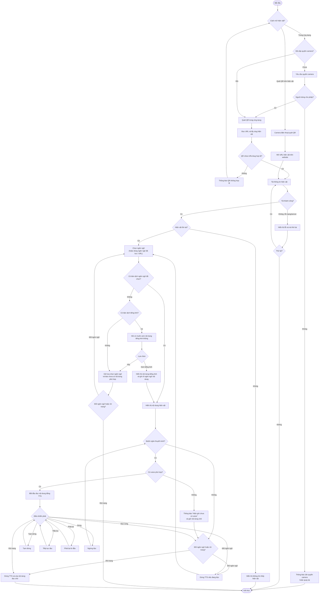

# Activity Diagram — Luồng thuyết minh hiện vật

Lược đồ mô tả luồng chính của khách tham quan theo [PRD](./PRD.md): mở hiện vật bằng QR hoặc tìm trong ứng dụng, chọn ngôn ngữ, đọc nội dung và tùy chọn nghe thuyết minh.

**Quy tắc thể hiện trong lược đồ:** QR in tại hiện vật mở URL web; trong ứng dụng, QR URL được phân tích để lấy slug. Nội dung tiếng Anh dự phòng chỉ hiển thị sau khi người dùng xác nhận và không tự đổi ngôn ngữ đã chọn. TTS chỉ phát theo thao tác chủ động; khi đổi ngôn ngữ hoặc rời trang, TTS đang phát phải dừng.
